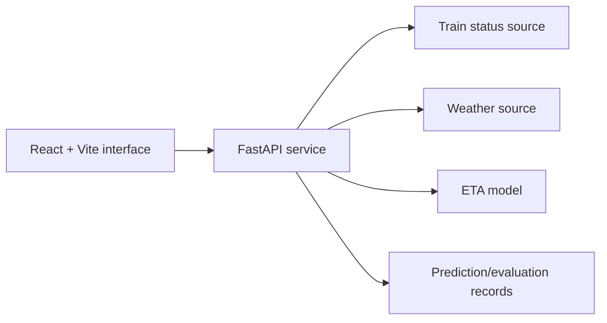

# RailFlow AI | Railway Operations Prototype

A local-first rail operations prototype that combines a React/Vite interface, a Python API, weather and train-feed integrations, and an ETA prediction workflow.

## System overview

The frontend contains passenger/staff views and operational simulation screens. The backend exposes live-source status, train lookup, prediction, evaluation/model information, and what-if/simulation flows. External feeds and model artifacts can be unavailable or stale, so this should be treated as a prototype rather than a live railway control system.



## Layout

- `backend/` — API, model assets, logs, and Python dependencies.
- `frontend/src/` — passenger/staff interface, maps, and dashboards.
- `docs/` — project documentation.
- `.env.example`, `docker-compose.yml`, and `test_all_features.py` — configuration, local orchestration, and test source.

## Run locally

Use Docker Compose from the repository root if its external configuration is available:

```bash
docker compose up --build
```

Otherwise install backend dependencies from `backend/requirements.txt` and frontend dependencies from `frontend/package.json`, then start the two services using their declared scripts. The project documentation describes a local backend at port 8000; verify compose and app settings before relying on ports.

## Configuration and API

Copy `.env.example` to a local environment file and configure only required integrations. Route source documents live under `backend/`; the README/API module lists live train lookup, prediction, metrics/evaluation, model card, source status, what-if, and simulation operations. No public production deployment is specified.

## Next steps

Document data freshness, model training/evaluation method, and external-source failure behavior. No repository-level `LICENSE` file was found, so reuse terms for project code are unspecified.
